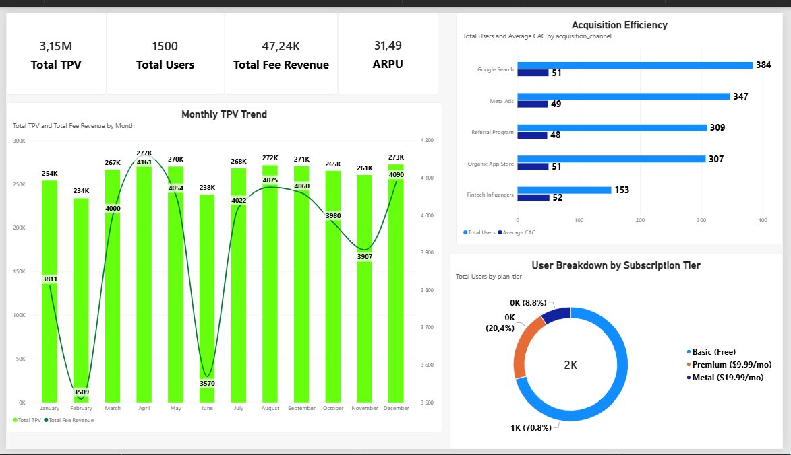
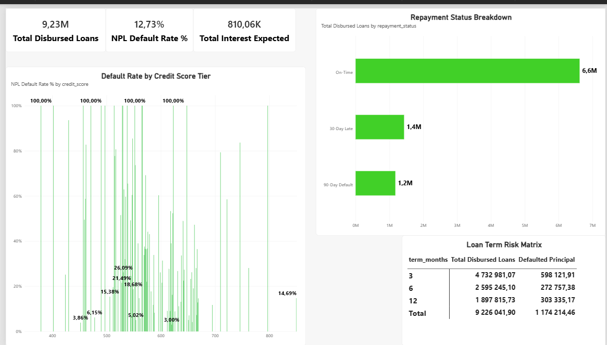
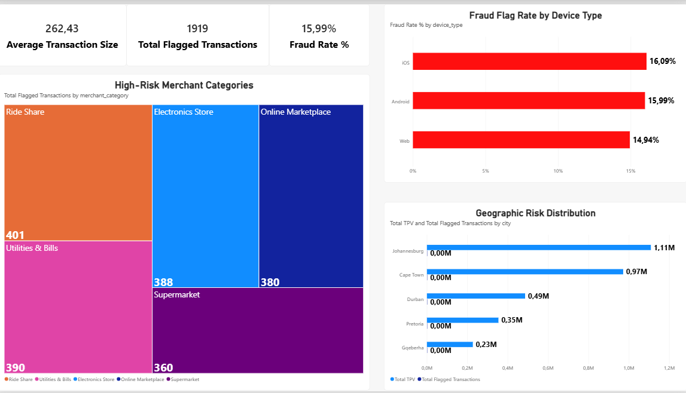

# 🏦 Project 51: Fintech & Digital Banking Analytics Solution

## 🚀 Executive Summary
Welcome to **Project 51**, a production-grade analytics solution engineered for a modern fintech startup operating digital accounts, micro-credit lines, and investment services. This project models complex financial transactions, high-risk lending metrics, subscription tiers, and fraud detection mechanisms to equip executive leaders with real-time operational visibility.

---

## 🏗️ Architecture & Data Pipeline
Built using a robust relational **Star Schema** generated via Python and modeled in Power BI:

* **Fact Tables:** 
  * `Fact_Transactions`: Captures 12,000+ payments, transfers, merchant settlements, fee revenues, and fraud risk flags.
  * `Fact_Loans`: Tracks micro-credit performance, principal amounts, terms, and Non-Performing Loan (NPL) default tracking.
* **Dimension Tables:** 
  * `Dim_Users`: 1,500 profiles covering KYC verification, credit scores, monthly incomes, subscription plan tiers (*Basic, Premium, Metal*), and acquisition channels.
  * `Dim_Products`: Core digital banking and financial service offerings.

  ---

## 📊 Dashboard Preview & Page Breakdown

### 1️⃣ Executive Growth & Unit Economics (`EG&UE`)
Focuses on top-line volume, user acquisition efficiency, and subscription mix.
* **Key Metrics:** Total Payment Volume (TPV), Total Fee Revenue, Active Users, and ARPU.
* **Visual Highlights:** Monthly TPV trend lines, user distribution across subscription tiers, and acquisition channel efficiency tracking (CAC vs. volume).



---

### 2️⃣ Credit Risk & Micro-Credit Portfolio Performance (`CR&LPP`)
Evaluates short-term lending health and loan default exposure.
* **Key Metrics:** Disbursed Loan Volume, NPL Default Rate %, and Expected vs. Defaulted Capital.
* **Visual Highlights:** Default rates mapped across credit score tiers, repayment status matrices (*On-Time, 30-Day Late, 90-Day Default*), and term-length risk breakdowns.



---

### 3️⃣ Transaction Velocity & Fraud Risk Monitoring (`TV&FRM`)
Tracks compliance risk, transaction security, and suspicious activities.
* **Key Metrics:** Flagged Fraud Count, Fraud Rate %, and Average Transaction Size.
* **Visual Highlights:** Fraud rates by device type (*iOS, Android, Web*), high-risk merchant category treemaps, and geographic risk distributions.



---

## ⚙️ Key DAX Measures Implemented
```dax
-- Total Payment Volume (TPV)
Total TPV = SUM(Fact_Transactions[amount])

-- Non-Performing Loan (NPL) Default Rate %
NPL Default Rate % = 
DIVIDE(
    CALCULATE(SUM(Fact_Loans[principal_amount]), Fact_Loans[is_defaulted] = 1),
    SUM(Fact_Loans[principal_amount]),
    0
)

-- Fraud Flag Rate %
Fraud Rate % = 
DIVIDE(
    CALCULATE(COUNT(Fact_Transactions[transaction_id]), Fact_Transactions[is_flagged_fraud] = 1),
    COUNT(Fact_Transactions[transaction_id]),
    0
)
💡 Conclusion & Business Impact
Project 51 demonstrates advanced competency in financial data modeling, risk scoring metrics, and unit economics tracking. By combining clean Python data generation with rigorous Power BI semantic modeling, this solution provides complete transparency over user acquisition ROI, credit risk mitigation, and fraud detection.